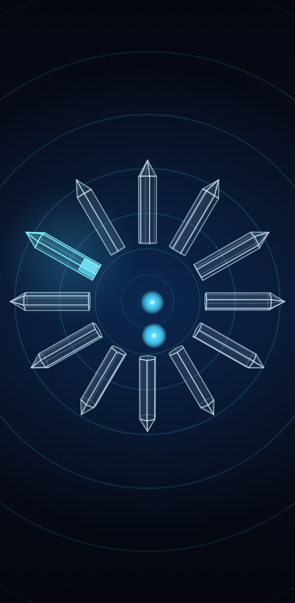
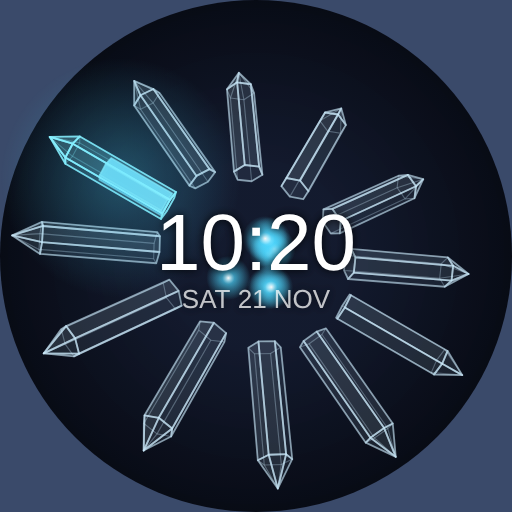

# Crystal Clock

A clock for Android, inspired by the crystal clock in the PS2 system menu. Twelve hexagonal crystal rods form the face of an analog clock. The rod for the current hour is full of liquid at the top of the hour and drains as the minutes pass. As a live wallpaper, the whole ring turns once a minute and seven orbs swirl in the middle, gathering into groups on round seconds. It also comes as a home-screen widget.

## Install on your phone

1. On your phone, open https://github.com/ajone79/crystal-clock-widget/releases/latest
2. Tap **CrystalClock.apk** to download it.
3. Open the downloaded file.
4. If asked, tap **Settings**, turn on **Allow from this source**, then go back.
5. Tap **Install**.
6. Open the **Crystal Clock** app.
7. Tap **Set as live wallpaper**, then tap **Set wallpaper**.
8. Tap **Add widget to home screen**, then tap **Add** (optional).

## Add the widget by hand

1. Long-press an empty spot on your home screen.
2. Tap **Widgets**.
3. Find **Crystal Clock**.
4. Drag it onto the home screen.
5. Long-press it and drag the edges to resize.

## Change the look

1. Tap the widget (or open the Crystal Clock app).
2. Pick a style: **Crystal rods** (3D) or **Gem ring** (flat, one gem per 5 minutes).
3. Pick **Drain**, **Fill up**, or **Fill one hour, drain the next**.
4. Pick a colour: Aqua, Amethyst, Ruby, Emerald, or Amber.
5. Turn the widget's dark background and time on or off.
6. Tap **Play a demo** to watch two hours in 10 seconds.

## Update to a newer build

1. Download **CrystalClock.apk** again from the releases link above.
2. Open it and tap **Update**.

## If it stops updating

1. Open **Settings > Apps > Crystal Clock > Battery**.
2. Choose **Unrestricted**.

## Build it yourself (optional)

1. Install Android Studio.
2. Open this folder in Android Studio.
3. Press **Run**.

Every push to `main` also builds the APK on GitHub Actions and puts it on the `latest` release.
