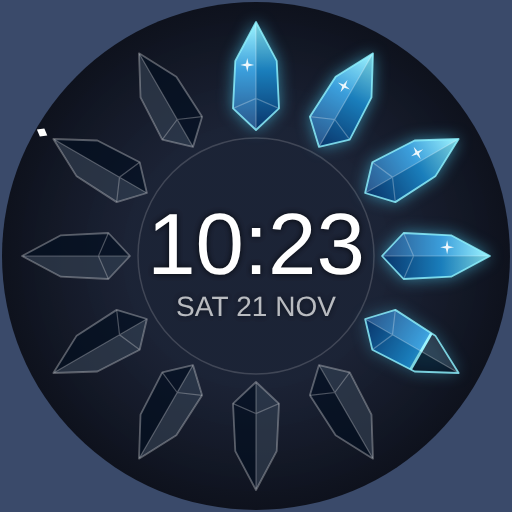
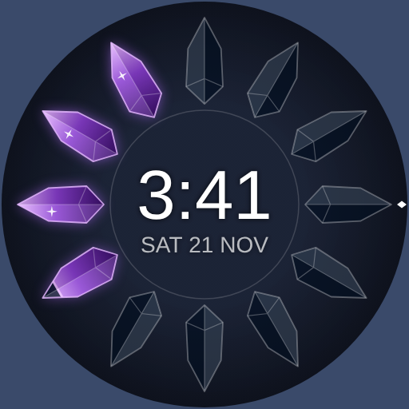
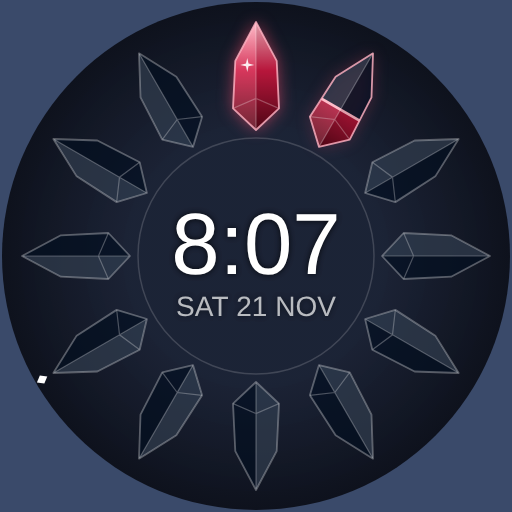

# Crystal Clock

An Android home-screen widget: a ring of 12 crystals around the time. Each crystal is 5 minutes. The crystals fill up (or drain) through the hour, and a small diamond outside the ring marks the hour.

## Install on your phone

1. On your phone, open https://github.com/ajone79/crystal-clock-widget/releases/latest
2. Tap **CrystalClock.apk** to download it.
3. Open the downloaded file.
4. If asked, tap **Settings**, turn on **Allow from this source**, then go back.
5. Tap **Install**.
6. Open the **Crystal Clock** app.
7. Tap **Add widget to home screen**, then tap **Add**.

## Add the widget by hand

1. Long-press an empty spot on your home screen.
2. Tap **Widgets**.
3. Find **Crystal Clock**.
4. Drag it onto the home screen.
5. Long-press it and drag the edges to resize.

## Change the look

1. Tap the widget (or open the Crystal Clock app).
2. Pick **Fill up**, **Drain**, or **Fill one hour, drain the next**.
3. Pick a colour: Aqua, Amethyst, Ruby, Emerald, or Amber.
4. Turn the dark background on or off.
5. Tap **Play a demo hour** to watch it run.

## Update to a newer build

1. Download **CrystalClock.apk** again from the releases link above.
2. Open it and tap **Update**.

## If it stops updating

1. Open **Settings > Apps > Crystal Clock > Battery**.
2. Choose **Unrestricted**.

## Build it yourself (optional)

1. Install Android Studio.
2. Open this folder in Android Studio.
3. Press **Run**.

Every push to `main` also builds the APK on GitHub Actions and puts it on the `latest` release.
